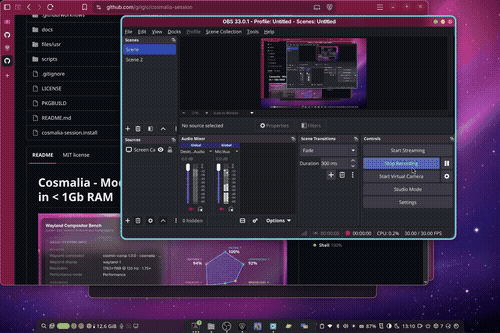

# Cosmalia — the modern minimal Linux Desktop in less than 400 MB



A minimal COSMIC-based Wayland desktop in less than 400 MB, combining **cosmic-comp-traffic** (compositor with macOS-style traffic-light buttons, Wayland blur, 3-finger workspace swipes, in-process Alt+Tab) and **Noctalia** (bar, dock, launcher, notifications, lock screen, idle/suspend, MPRIS, polkit agent).

## Install

### Arch Linux (recommended)

```sh
# From GitHub release
gh release download --latest -R grigio/cosmalia-session -p '*.pkg.tar.zst' -D /tmp/cosmalia
sudo pacman -U /tmp/cosmalia/*.pkg.tar.zst

# Or build locally
makepkg -fi
```

### Fedora

```sh
# From GitHub release
gh release download --latest -R grigio/cosmalia-session -p '*.rpm' -D /tmp/cosmalia-session
sudo dnf install /tmp/cosmalia-session/*.rpm

# Or build locally
rpmbuild -ba cosmalia-session.spec
sudo dnf install ~/rpmbuild/RPMS/noarch/cosmalia-session-*.noarch.rpm
```

### NixOS

```nix
# flake.nix
{
  inputs = { cosmalia-session.url = "github:grigio/cosmalia-session"; };
  outputs = { self, nixpkgs, cosmalia-session, ... }: {
    nixosConfigurations.your-host = nixpkgs.lib.nixosSystem {
      system = "x86_64-linux";
      modules = [
        cosmalia-session.nixosModules.cosmalia-session
        ({ config, ... }: { services.cosmalia-session.enable = true; })
      ];
    };
  };
}
```

## After Install

Cosmalia appears in your greeter (greetd, GDM, SDDM, etc.) as **Cosmalia** but is **not** the default.

To make it default (gtkgreet):
```sh
sudo cosmalia-session-default
```

To only add it to the dropdown without changing the default:
```sh
sudo cosmalia-session-default --list
```

## Requirements (installed automatically as dependencies)

| Package | Role |
|---------|------|
| `cosmic-comp-traffic` | Patched compositor (traffic lights, gestures, Alt+Tab) |
| `noctalia` | Shell: bar, dock, launcher, lock, notifications, polkit |
| `cosmic-settings-daemon` | Live theme/keybind updates |
| `xdg-desktop-portal-wlr` | Screencast/Screenshot portal |
| `xdg-desktop-portal-gtk` | FileChooser (GTK4 picker) |
| `polkit`, `gnome-keyring`, `wireplumber` | System integration |

Optional: `cosmic-settings`, `cosmic-screenshot`, `inotify-tools`, `polkit-gnome`, `zram-generator`, `systemd-oomd`

`xdg-desktop-portal-cosmic` is intentionally **not** used: it is currently buggy. Screen recording goes through the wlr backend and file dialogs through the GTK backend. The GNOME backend is not used either, because it requires GNOME Shell/Mutter service channels that Cosmalia does not run.

## What Runs

Started by `cosmalia-session.target`:
- `cosmic-comp --no-xwayland` — compositor
- `noctalia.service` — shell (restarted on crash)
- `cosmic-settings-daemon.service` — config watchers
- `xdg-desktop-portal` + wlr backend — restarted per login

D-Bus/system activated: `xdg-desktop-portal-gtk`, `pipewire`/`wireplumber`, `gnome-keyring`, `gvfs` (if installed)

## Configuration

### XWayland

Disabled by default. To enable it for your user, create `~/.config/cosmalia/session.conf`:

```sh
mkdir -p ~/.config/cosmalia
echo 'COSMALIA_NO_XWAYLAND=0' > ~/.config/cosmalia/session.conf
```

Log out and log back in. The launcher reads this file only when the variable is not already set in its environment, so a value exported by your greeter (or NixOS' `services.cosmalia-session.enableXWayland`) still takes precedence. No `systemctl --user` reload is needed.

### zram (optional, helps stay under 400 MB)

```sh
# Arch
sudo pacman -S zram-generator
# Fedora
sudo dnf install zram-generator

echo -e '[zram0]\nzram-size = min(ram, 4096)\ncompression-algorithm = zstd\nswap-priority = 100' | sudo tee /etc/systemd/zram-generator.conf
sudo systemctl enable --now systemd-zram-setup@zram0.service
```

### Portal routing

`/usr/share/xdg-desktop-portal/cosmalia-portals.conf` routes:
- `FileChooser` → GTK backend
- `ScreenCast`/`Screenshot` → wlr backend

Interfaces that need the cosmic backend (Settings, RemoteDesktop, Access) are unavailable by design until it works reliably. Notifications are handled directly by Noctalia. On NixOS the module also routes `Camera` to the GNOME backend for GNOME Snapshot; on Arch/Fedora that backend is not used because it requires GNOME Shell/Mutter.

## Logs

```sh
# Compositor/launcher
tail -f "$XDG_RUNTIME_DIR/cosmalia-session.log"

# Shell & settings daemon
journalctl --user -b -u noctalia.service -u cosmic-settings-daemon.service
```

## Troubleshooting

| Issue | Check |
|-------|-------|
| Noctalia won't start | `journalctl --user -b -u noctalia.service` |
| Screenshots fail | `systemctl --user status xdg-desktop-portal.service org.freedesktop.impl.portal.desktop.wlr.service` |
| File dialogs broken | `pacman -Q xdg-desktop-portal-gtk` and check `cosmalia-portals.conf` exists |
| Traffic lights missing | `pacman -Q cosmic-comp-traffic` — must provide `/usr/bin/cosmic-comp` |
| Greeter doesn't default | Run `sudo cosmalia-session-default` |

## Uninstall

```sh
# Arch
sudo pacman -R cosmalia-session

# Fedora
sudo dnf remove cosmalia-session

# Manual (install.sh)
sudo rm /usr/share/wayland-sessions/cosmalia.desktop \
        /usr/bin/cosmalia-session \
        /usr/bin/cosmalia-session-default \
        /usr/lib/systemd/user/cosmalia-session.target \
        /usr/lib/systemd/user/noctalia.service \
        /usr/lib/systemd/user/cosmic-settings-daemon.service \
        /usr/share/xdg-desktop-portal/cosmalia-portals.conf
systemctl --user daemon-reload

# NixOS: remove from flake
```

If Cosmalia was the greeter default, restore your previous config first (the package's `pre_remove` warns about this).

## Upgrading from `cosmic-comp-traffic-session`

The package `Obsoletes`/`Conflicts` with the old name. Installing `cosmalia-session` replaces it automatically. The helper also removes the old launcher from gtkgreet.

## Files Installed

| Path | Purpose |
|------|---------|
| `/usr/bin/cosmalia-session` | Session launcher |
| `/usr/bin/cosmalia-session-default` | Greeter helper |
| `/usr/share/wayland-sessions/cosmalia.desktop` | XDG session entry |
| `/usr/share/xdg-desktop-portal/cosmalia-portals.conf` | Portal routing |
| `/usr/lib/systemd/user/cosmalia-session.target` | Session target |
| `/usr/lib/systemd/user/noctalia.service` | Shell service |
| `/usr/lib/systemd/user/cosmic-settings-daemon.service` | Config watcher service |

## License

MIT — see [LICENSE](LICENSE)
