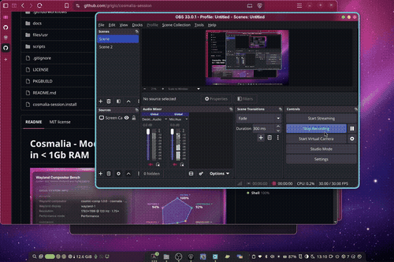
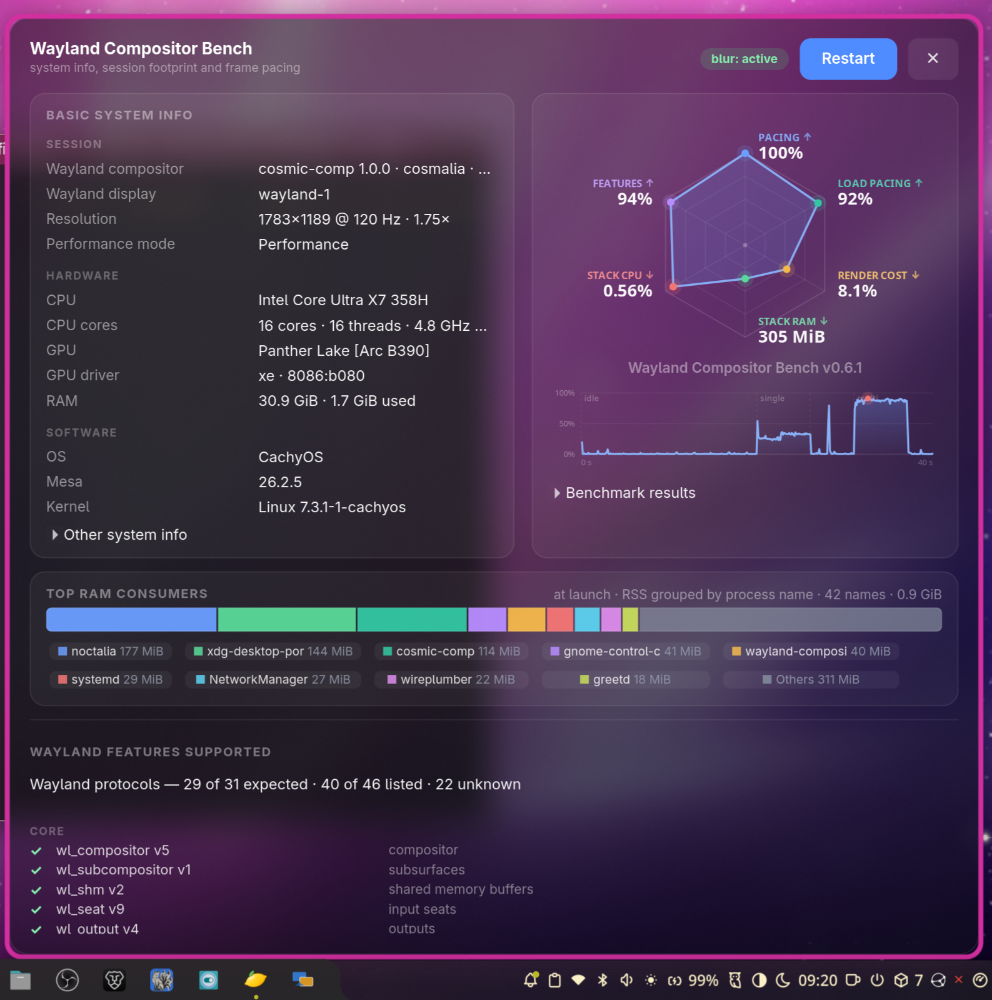

# Cosmalia — A Modern, Minimal Linux Desktop Under 1 GB RAM



Cosmalia is a lightweight, modern Linux desktop that runs in under 1 GB of RAM. It combines two projects:

- **cosmic-comp** — the COSMIC compositor with macOS-style traffic-light window buttons, Wayland blur, animations, 3-finger workspace swipes, and built-in Alt+Tab
- **Noctalia** — the shell: bar, dock, launcher, notifications, networking, lock screen, idle/suspend, MPRIS, screensaver, and a polkit agent

The `cosmalia-session` package ties them together as an XDG session. It appears in any Wayland login manager (greetd, GDM, SDDM, etc.). The login manager itself is up to you.

Installing Cosmalia won't change your default session. It's available to pick, but your current default stays put. Making it the default is a separate, explicit step (see [Making it the greeter default](#making-it-the-greeter-default)).

## The Stack



| Component | Job |
|---|---|
| `cosmic-comp` | Wayland compositor; installs as `/usr/bin/cosmic-comp` |
| `noctalia` | Bar, dock, launcher, notifications, networking, lock screen, idle/suspend, MPRIS, polkit agent, screensaver |
| `cosmalia-session` | This package: session launcher, XDG session entry, systemd user units, optional greeter helper |
| `xdg-desktop-portal-cosmic` | Portal backend for screen sharing, screencast, screenshots, remote desktop, settings |
| `xdg-desktop-portal-gnome` | Portal backend for the file chooser only — gives you GNOME's GTK4/libadwaita picker (drawn by Nautilus) instead of COSMIC's |
| `cosmic-settings` | Settings app for controlling cosmic-comp features |
| `cosmic-settings-daemon` | Watches cosmic-config changes so theme, appearance, and keybind edits apply live |
| `cosmic-screenshot` | Screenshot utility that goes through the portal |
| `polkit` | Provides `polkit-agent-helper-1` for the polkit agent |
| `polkit-gnome` | Optional fallback polkit agent; Noctalia already registers one, so run only one |
| `gnome-keyring` | Secret Service for browsers and apps; unlocked by PAM at login |

Not included — install separately if needed: `voxtype` (voice typing), `syncthing` (file sync), `gvfs` (trash, recent files, MTP/network mounts). Some COSMIC features need extra components; this session stays minimal on purpose.

### zram-generator (recommended for < 1 GB RAM)

The `zram-generator` optdepend provides compressed RAM swap, which helps stay under the 1 GB target. Example config at `/etc/systemd/zram-generator.conf`:

```ini
[zram0]
zram-size = min(ram, 4096)
compression-algorithm = zstd
swap-priority = 100
```

Enable with `sudo systemctl enable --now systemd-zram-setup@zram0.service`.

The `cosmic-comp` package provides the COSMIC compositor with traffic-light window buttons. To switch to a different compositor: `sudo pacman -S <compositor>`.

## Install

Three ways, all installing the same files — use one, and prefer the package so pacman owns `/usr`:

```sh
# A) the published package (recommended)
gh release download --latest -R grigio/cosmalia-session \
  -p '*.pkg.tar.zst*' -D /tmp/cosmalia-session
cd /tmp/cosmalia-session && sha256sum -c ./*.pkg.tar.zst.sha256
sudo pacman -U ./*.pkg.tar.zst
# Cosmalia is installed, but NOT the default.
sudo cosmalia-session-default        # optional: make it the default

# B) build it locally from this checkout
makepkg -fi
sudo cosmalia-session-default        # optional: make it the default

# C) straight from the checkout, no package
./scripts/install.sh                 # session + helper + docs, not default
./scripts/install.sh --default       # ... and make it the default
```

### Fedora

```sh
# A) the published package (recommended)
gh release download --latest -R grigio/cosmalia-session \
  -p '*.rpm' -D /tmp/cosmalia-session
cd /tmp/cosmalia-session && sha256sum -c ./*.rpm.sha256
sudo dnf install ./cosmalia-session-*.noarch.rpm
# Cosmalia is installed, but NOT the default.
sudo cosmalia-session-default        # optional: make it the default

# B) build it locally from this checkout
rpmbuild -ba cosmalia-session.spec
sudo dnf install ~/rpmbuild/RPMS/noarch/cosmalia-session-*.noarch.rpm
sudo cosmalia-session-default        # optional: make it the default

# C) straight from the checkout, no package
./scripts/install.sh                 # session + helper + docs, not default
./scripts/install.sh --default       # ... and make it the default
```

None of these edit `/etc/greetd` unless you pass `--default` or run `cosmalia-session-default`. Greeters that read `/usr/share/wayland-sessions` (Noctalia Greeter, GDM, SDDM) list Cosmalia immediately; gtkgreet only lists `/etc/greetd/environments` plus its `-c` argument. To add Cosmalia to a gtkgreet dropdown without changing the default:

```sh
sudo cosmalia-session-default --list
```

See [Making it the greeter default](#making-it-the-greeter-default) for the default itself.

`install.sh` warns if `cosmic-comp` is not installed and if `xdg-desktop-portal-gnome` is missing (file dialogs would stay COSMIC's). The session itself also checks the compositor at login and logs a warning. It refuses to run as root, and refuses if either `cosmalia-session` or the old `cosmic-comp-traffic-session` package is installed, so pacman's file list stays accurate.

### The package

#### Arch Linux

`arch=(any)`, no sources (it packages this tree). It installs the launcher, the XDG session entry, the session target, the two services, the portal configuration, the greeter helper, and the docs under `/usr/share/doc/cosmalia-session/`.

`pkgver` comes from the nearest `v<major>.<minor>.<patch>` tag and `pkgrel` from the number of commits that touched packaged files, so a local `makepkg` matches the CI-built package for the same commit. Both can be overridden:

```sh
SESSION_VERSION=1.2.3 SESSION_PKGREL=12 makepkg -f
```

Every `v*` tag is built by `.github/workflows/arch-package.yml` in an `archlinux:base-devel` container and attached to its GitHub release. A rebuild of the same tag still works because `pkgrel` is part of the filename.

`cosmic-comp` is in the official repositories, so `makepkg` works without `--nodeps`. `noctalia` and the COSMIC packages are in `extra`; on CachyOS the CachyOS repositories carry the same packages.

The post-install message tells you Cosmalia was **not** made the default, how to add it to a gtkgreet dropdown, and how to make it the default; `pre_remove` warns to point the greeter at another session first.

#### Fedora

The Fedora RPM package is built from `cosmalia-session.spec` by `.github/workflows/fedora-package.yml` in a `fedora:latest` container. It installs the same files with Fedora paths (`/usr/lib/systemd/user/` for user units). Version comes from the tag and release from git history (same scheme as Arch). Every `v*` tag produces a noarch RPM and a source RPM attached to the GitHub release.

All COSMIC dependencies (`cosmic-comp`, `noctalia`, `cosmic-settings`, `cosmic-settings-daemon`, `cosmic-screenshot`) are available in Fedora repositories. The package uses `Recommends` for optional dependencies (`polkit-gnome`, `zram-generator`, `systemd-oomd`). It `Obsoletes`/`Conflicts` with the old `cosmic-comp-traffic-session` package.

### Upgrading from `cosmic-comp-traffic-session`

The package `provides`, `replaces` and `conflicts` with the old name, so installing `cosmalia-session` replaces the old package and removes its `cosmic-comp-traffic.desktop`, launcher and systemd target. `cosmalia-session-default` also drops the old launcher from `/etc/greetd/environments`, so the greeter doesn't list a dead entry. If you installed with `scripts/install.sh` instead, delete the old files by hand:

```sh
sudo rm /usr/share/wayland-sessions/cosmic-comp-traffic.desktop \
        /usr/local/bin/cosmic-comp-traffic-session \
        /usr/lib/systemd/user/cosmic-comp-traffic-session.target
systemctl --user daemon-reload
```

## What Runs

Started by the session, deliberately:

| Piece | Job |
|---|---|
| `cosmic-comp --no-xwayland` | Compositor (traffic lights, soft focus ring, `zwlr_foreign_toplevel_manager_v1`, 3-finger workspace swipe, in-process Alt+Tab) |
| `noctalia.service` | Bar, dock, launcher, notifications, lock screen, idle/suspend, MPRIS, polkit agent, screensaver; systemd restarts on failure |
| `cosmic-settings-daemon.service` | cosmic-config watchers: live theme, appearance and keybind changes |
| `xdg-desktop-portal` + `xdg-desktop-portal-cosmic` | Restarted per login: the cosmic backend has no `PartOf=graphical-session.target`, so it survives logout and would otherwise keep a stale `WAYLAND_DISPLAY` |

The two services are `PartOf=cosmalia-session.target`, so logout stops them with the target. They log to the journal and are not enabled in the user manager; starting the target is enough.

Already covered without starting anything here:

| Piece | Why it needs no session entry |
|---|---|
| `xdg-desktop-portal-gnome` | D-Bus activated by the first file dialog and stopped by `PartOf=graphical-session.target` — no session entry needed, never holds a stale socket |
| `xdg-desktop-portal-gtk` | Pulled in by the GNOME backend; `default=` falls back to it for interfaces cosmic doesn't implement, same D-Bus activation and lifecycle |
| D-Bus user bus (`dbus-broker`/`dbus-daemon`) | Started by the user manager |
| `pipewire`, `wireplumber` | Socket + enabled unit; audio and screencast |
| `gnome-keyring-daemon` | D-Bus/socket activated; PAM unlocks it at login (see below) |
| `gvfs-*`, `xdg-document-portal` | D-Bus activated on first use, if installed |
| `upower`, `power-profiles-daemon`, NetworkManager | System services, session agnostic |

The keyring is unlocked by PAM at login. Make sure your display manager's PAM file (`/etc/pam.d/greetd`, `/etc/pam.d/gdm-password`, …) loads `pam_gnome_keyring.so`; the current greetd config already does.

`cosmic-settings` and `cosmic-screenshot` are installed as part of the stack but are normal applications: they launch on demand, not by the session.

The compositor runs with `--no-xwayland` by default for security and resource usage. To enable XWayland (for legacy X11 apps), set `COSMALIA_NO_XWAYLAND=0` in your environment before starting the session (e.g., in `~/.profile` or a systemd drop-in).

### Systemd drop-in for XWayland

Create `/etc/systemd/user/cosmalia-session.target.d/xwayland.conf` (or user-local `~/.config/systemd/user/...`):

```ini
[Service]
Environment=COSMALIA_NO_XWAYLAND=0
```

Then `systemctl --user daemon-reload`. This affects only the session target, not the whole user environment.

Deliberately **not** part of the session:

- `xdg-desktop-portal-wlr`: not installed. Its `.portal` file declares `UseIn=wlroots`, and nothing here needs it. `xdg-desktop-portal-gnome` is installed only for `FileChooser`; its other interfaces go through gnome-shell, which this session doesn't run, so it stays out of `default=`.
- `gnome-keyring` in the session target: it must outlive the graphical session. Only one Secret Service provider may run; `oo7` or `keepassxc` are drop-in alternatives (`org.freedesktop.secrets`), gnome-keyring is what COSMIC itself pairs with.
- `polkit-gnome`: Noctalia registers its own polkit agent, so starting `polkit-gnome` too would give two agents. Keep it as a fallback for setups where Noctalia's agent is disabled; run `polkit-gnome-authentication-agent-1` at login in that case.
- `noctalia-labwc-sync.path`, `labwc-4finger-gestures.service`: labwc only (`ConditionEnvironment`, `wtype`); cosmic-comp handles both natively.
- `voxtype`, `syncthing`, `gvfs`: useful, but not part of a minimal session.
- COSMIC's own `cosmic-session`/panel/dock: replaced by Noctalia.

`XDG_CURRENT_DESKTOP=cosmalia:COSMIC` — the `:COSMIC` suffix makes xdg-desktop-portal select the cosmic backend; without it screenshots and screencast have no implementation. `cosmalia` comes first, so `/usr/share/xdg-desktop-portal/cosmalia-portals.conf` is the configuration file xdg-desktop-portal reads (first match wins): it keeps the cosmic backend for screenshots, screencast, remote desktop and settings, and names `gnome` for `FileChooser`.

## Files

| Repo path | Installed to | What |
|---|---|---|
| `files/usr/bin/cosmalia-session` | same | Session launcher: compositor → wait for socket → import env → restart portals → start session target |
| `files/usr/share/wayland-sessions/cosmalia.desktop` | same | XDG session entry, listed by the greeter as **Cosmalia** |
| `files/usr/share/xdg-desktop-portal/cosmalia-portals.conf` | same | Portal selection: GNOME for `FileChooser`, wlr for screenshots/screencast |
| `files/usr/lib/systemd/user/cosmalia-session.target` | same | Session target, `BindsTo=graphical-session.target`; pulls in the two services below |
| `files/usr/lib/systemd/user/noctalia.service` | same | Noctalia under systemd: `Restart=on-failure`, journal logging, `PartOf=` the session target |
| `files/usr/lib/systemd/user/cosmic-settings-daemon.service` | same | cosmic-config watchers under systemd, same lifecycle |
| `scripts/install.sh` | — | Copies session files, helper, and docs onto `/` |
| `scripts/verify.sh` | — | Verifies installation (binaries, units, portal config, session entry) |
| `scripts/set-default-greetd.sh` | `/usr/bin/cosmalia-session-default` | Opt-in: preselects the session in gtkgreet (or with `--list`, only lists it) |
| `PKGBUILD`, `cosmalia-session.install` | — | Package, built from this tree by CI on every `v*` tag |
| `.github/workflows/arch-package.yml` | — | Builds and publishes the package for a release tag |

The repo layout mirrors `/`, so installing is a copy and the files can be diffed against the live ones at any time.

## Logs

```sh
tail -f "$XDG_RUNTIME_DIR/cosmalia-session.log"   # launcher + compositor
journalctl --user -b -u noctalia.service -u cosmic-settings-daemon.service
```

The launcher/compositor log is truncated at each login. Noctalia and the settings daemon write to the journal, so nothing on the runtime tmpfs grows for the whole session.

## Troubleshooting

- **Noctalia doesn't start:** `journalctl --user -b -u noctalia.service`, then `tail "$XDG_RUNTIME_DIR/cosmalia-session.log"`. Check the compositor socket exists with `ss -xlp | grep wayland`.
- **Screenshots/screencast don't work:** Check `systemctl --user status xdg-desktop-portal.service org.freedesktop.impl.portal.desktop.cosmic.service` and that `XDG_CURRENT_DESKTOP` contains `COSMIC`. Portal logs are in the user journal.
- **File dialogs look like COSMIC's picker, or don't open:** The GNOME backend must be installed and selected. Check `pacman -Q xdg-desktop-portal-gnome`, `systemctl --user status xdg-desktop-portal-gnome.service` (inactive until first dialog — it's D-Bus activated), and that `/usr/share/xdg-desktop-portal/cosmalia-portals.conf` is present. A `portals.conf` in `~/.config/xdg-desktop-portal/` overrides the packaged one, and a unit drop-in setting `ConditionEnvironment` on the GNOME service skips it entirely.
- **GNOME backend logs `Failed to open service channel Wayland connection` or Nautilus logs `Cannot get portal org.freedesktop.portal.Inhibit version`:** Expected and harmless. No Mutter service channel under cosmic-comp, and `Inhibit` is disabled in `cosmalia-portals.conf` on purpose; the file dialog still opens.
- **Traffic-light decorations missing:** `pacman -Q cosmic-comp`; `/usr/bin/cosmic-comp` must come from the COSMIC package.
- **Greeter doesn't default to Cosmalia:** Intentional on install. Run `sudo cosmalia-session-default`, or pick Cosmalia once in the greeter (Noctalia Greeter remembers it).
- **Session log missing:** `XDG_RUNTIME_DIR` must exist; launch the session from a logind login, not a bare console.

## Reverting

```sh
# Back to previous greeter default (labwc) or any earlier one:
sudo cp -a /etc/greetd/config.toml.bak.<timestamp> /etc/greetd/config.toml
sudo cp -a /etc/greetd/environments.bak.<timestamp> /etc/greetd/environments

# Remove the session (package install):
sudo pacman -R cosmalia-session

# Remove the session (install.sh install):
sudo rm /usr/share/wayland-sessions/cosmalia.desktop \
        /usr/bin/cosmalia-session \
        /usr/bin/cosmalia-session-default \
        /usr/lib/systemd/user/cosmalia-session.target \
        /usr/lib/systemd/user/noctalia.service \
        /usr/lib/systemd/user/cosmic-settings-daemon.service \
        /usr/share/xdg-desktop-portal/cosmalia-portals.conf \
        /usr/share/doc/cosmalia-session/README.md \
        /usr/share/licenses/cosmalia-session/LICENSE
systemctl --user daemon-reload

# And the patched compositor, if wanted:
sudo pacman -S cosmic-comp
```

Removing the package doesn't restore the greeter config; if Cosmalia was the default, point the greeter elsewhere first (the `pre_remove` message says so).
## NixOS

Add this flake to your NixOS configuration:

```nix
# flake.nix
{
  inputs = {
    nixpkgs.url = "github:NixOS/nixpkgs/nixos-unstable";
    cosmalia-session.url = "github:grigio/cosmalia-session";
  };

  outputs = { self, nixpkgs, cosmalia-session, ... }: {
    nixosConfigurations.your-host = nixpkgs.lib.nixosSystem {
      system = "x86_64-linux";
      modules = [
        cosmalia-session.nixosModules.cosmalia-session
        ({ config, pkgs, ... }: {
          services.cosmalia-session = {
            enable = true;
            # Make Cosmalia the default greeter session (requires greetd)
            defaultSession = true;
            # Enable XWayland support for legacy X11 apps
            enableXWayland = true;
            # Add extra packages to the session environment
            extraPackages = [ pkgs.firefox pkgs.vscode ];
          };
        })
      ];
    };
  };
}
```

Then rebuild:

```sh
sudo nixos-rebuild switch --flake .#your-host
```

### NixOS Module Options

| Option | Type | Default | Description |
|---|---|---|---|
| `services.cosmalia-session.enable` | boolean | `false` | Enable Cosmalia session |
| `services.cosmalia-session.defaultSession` | boolean | `false` | Make Cosmalia the default greeter session |
| `services.cosmalia-session.enableXWayland` | boolean | `false` | Enable XWayland support |
| `services.cosmalia-session.extraPackages` | list of packages | `[]` | Additional packages for the session |

### Using the Overlay

If you want to use the package in your own flake without the module:

```nix
# flake.nix
{
  inputs = {
    nixpkgs.url = "github:NixOS/nixpkgs/nixos-unstable";
    cosmalia-session.url = "github:grigio/cosmalia-session";
  };

  outputs = { self, nixpkgs, cosmalia-session, ... }: {
    nixosConfigurations.your-host = nixpkgs.lib.nixosSystem {
      system = "x86_64-linux";
      modules = [
        ({ config, pkgs, ... }: {
          # The overlay makes cosmalia-session available in pkgs
          nixpkgs.overlays = [ cosmalia-session.overlays.default ];
          
          environment.systemPackages = [ pkgs.cosmalia-session ];
        })
      ];
    };
  };
}
```

### Development Shell

Enter a development shell with all dependencies:

```sh
nix develop github:grigio/cosmalia-session
```

